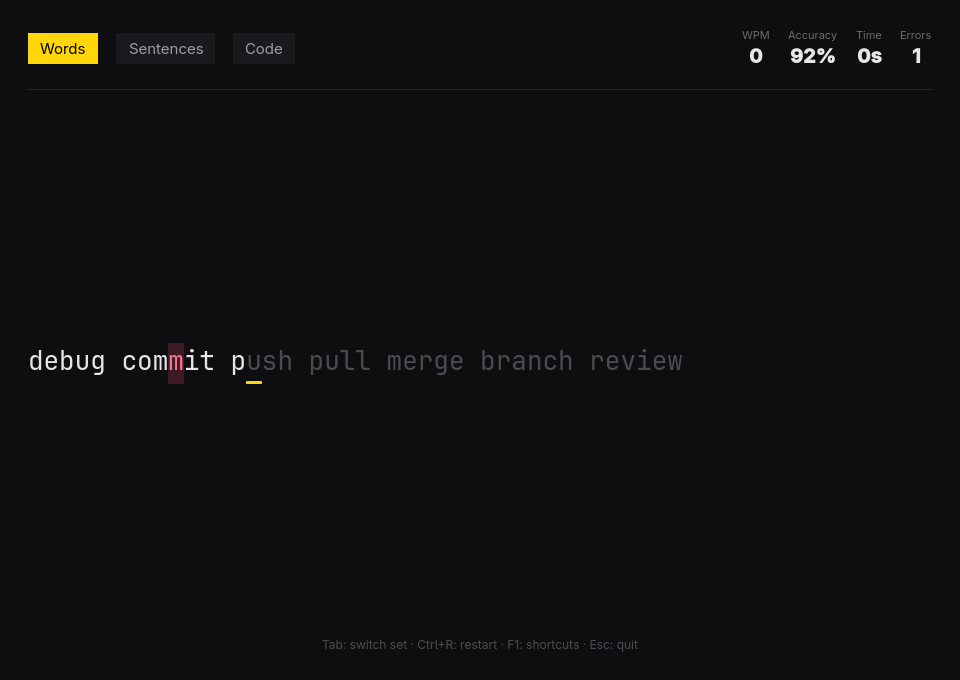

# Typist



Keyboard typing practice for Omarchy. A line of text appears, you type it,
and Typist colors every character as you go and scores your speed (WPM) and
accuracy live. Three practice sets: common words, sentences, and one-line
code snippets.

Typist follows the Omarchy theme and language live, like the rest of the
desktop.

## Shortcuts

| Key | Action |
|-----|--------|
| Type | Fill in the text |
| Backspace | Erase a character |
| Tab | Switch practice set |
| Ctrl+1 / Ctrl+2 / Ctrl+3 | Jump to a set |
| Ctrl+R | Restart this text |
| Space | Next text when done |
| F1 | Toggle the shortcut help |
| Esc | Close / quit |

## Build and install

```sh
bin/build    # compile into build/typist
bin/test     # run the offscreen test suite
bin/install  # build and install the Arch package
```

The package puts `typist` on the PATH and adds Typist to the Omarchy app
launcher (Super+Space).
